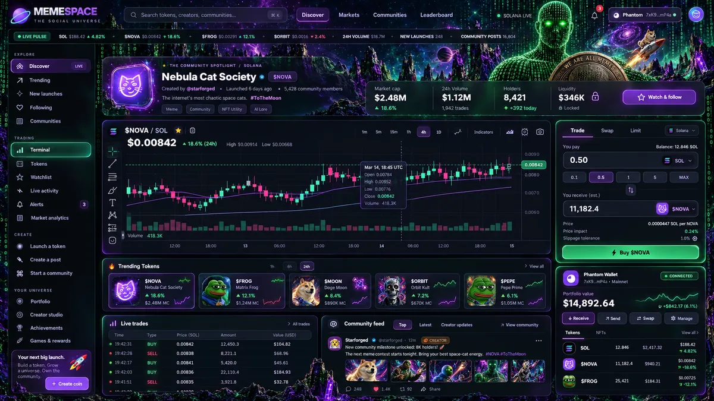
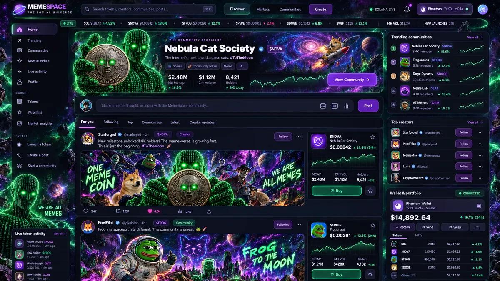
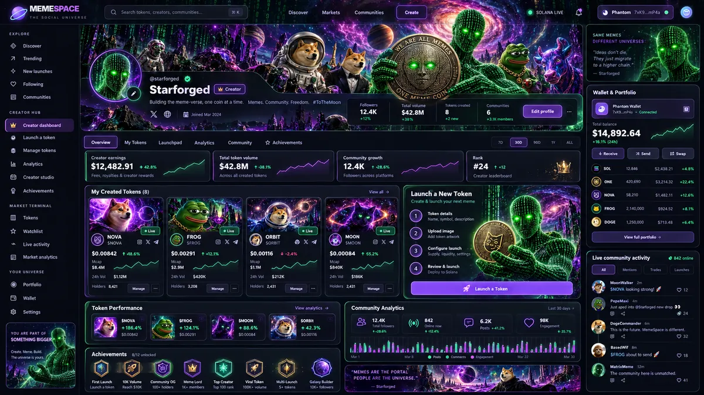

# MemeSpace Mind — Market & Community Node
> Engineering and visual implementation blueprint for [Issue #25](https://github.com/DPN-Technology/MemeSpace/issues/25). This document is a specification, not a claim that the features are implemented.

## Original MemeSpace UI concepts

These are web-optimized copies of the actual generated UI images selected for issue #25, **not a recreated diagram**.

### Trading Terminal



### Social & Community



### Creator Studio



## Design directive

**Do not replace the Meme Mind. Add a new, premium neural node to it.** Users enter through the existing animated binary head, access the 3D brain, and activate the new **Market & Community** receptor. Inside that single node, they can discover tokens, follow creators, interact with communities, review a Phantom-connected wallet, see portfolios, enter creator tools, and trade when secure execution is implemented. Returning to the brain preserves route context where feasible.

The source art supplied by the product owner establishes the brand: luminous **purple / acid-green 0s and 1s**, binary humanoid with glowing eyes, engraved ONE MEME COIN, surreal meme characters, cosmic architecture, and a dense dark background. **Use the art for the node identity, portals, mastheads, hero banners, empty states and creator cards, never as an unreadable backdrop for prices, buttons or legal notices.** Use restrained motion and layered contrast on the actual app surfaces.

The concept SVG above is a **redrawn interface reference**, not a live screenshot or real market feed. Illustration metrics are placeholders, never shipped as actual wallet or market data.

## Repository touchpoints, verified against current main

| Existing piece | Current location | Work |
|---|---|---|
| Mind module registry and clickable receptors | `app/page.tsx` — `Key`, `modules`, `open()`, `ModuleContent` | Add `market` module and meaningful icon, preview, node position; keep existing nodes |
| Dynamic brain reaction | `app/scene.tsx` — `receptors`, `focus`, particle/color rendering | Add `market` receptor coordinates and optional market green/violet pulse; do not regress other nodes |
| Deep link/history and Cmd+K module discovery | `app/page.tsx` — URL fragment, registered `open_memespace_module`, `modules` | Include new node in deep links, tools, keyboard search and menu |
| Workspace modal and responsive module presentation | `app/page.tsx`, `app/globals.css`, component styles | Add dedicated full-screen/wide `MarketCommunityWorkspace`, not a cramped generic card |
| Existing wallet module | `app/module-upgrades.tsx` | Reuse Phantom state where viable; harden auth and session lifecycle; avoid duplicate wallet stacks |
| Community + account/identity | `app/chat-upgrade.tsx`, `app/identity-center.tsx`, `app/identity-scope.tsx` | Bridge into token spaces through shared user/account identities; preserve existing data |
| Games | `app/arcade` | Leave intact; integrate rewards only in a later separately gated phase |

**Do not assume** the existing Wallet module is already production-ready Solana trading or that `Key`-based workspaces imply a live exchange. Inventory dependencies and backend routes before adding financial activity.

## Mind-level UX / spatial design

- Brain node name: **Market & Community**. Secondary internal label: **THE MEMEVERSE EXCHANGE** (branding only, not a representation of exchange or custody status).
- Suggested receptor placement: right/upper-side distinct from existing `coins`, `chat`, `wallet`; choose actual coordinates only after desktop, tablet and mobile collision tests. Add keyboard-focus ring, ARIA name, touch target and accessible list/menu fallback.
- Hover/focus: neon-green pulse radiates from receptor, faint purple circuits trail to **Wallet**, **Memecoin History**, **Chat** and **Profile** receptors. Use existing scene renderer and reduce-motion and quality settings. Do not run heavy particle work while content workspace is open.
- On activation: fluid portal transition into a branded workspace; show persistent **Return to Mind**, breadcrumb, active network, user/wallet state and feedback for loading/error/offline. Allow deep-link/refresh/back navigation without trapping the user.
- Desktop: market data, community and wallet can coexist. Tablet: tabbed main view with optional trade sheet. Mobile: sticky compact trade/wallet action and distinct full-screen chart/community modes.
- No forced wallet connection to browse. Read-only public mode must work without a wallet.

## Workspace information architecture

```text
MEME MIND
  └── MARKET & COMMUNITY NODE
      ├── Discover: Following / Trending / New / Watchlist
      ├── Token Space: token identity + creator + community + chart + live trades + risk signals
      ├── Community: Feed / Posts / Media / Replies / Moderation
      ├── Trading: Buy / Sell / Swap / Confirmations / Receipts
      ├── Portfolio: Holdings / P&L provenance / Transactions
      ├── Creator Studio: Profile / Launch / Created coins / Insights / Management
      ├── Notifications: Follows / Mentions / Holdings / Trade state
      └── Identity: Shared profile + account security + Phantom wallet permissions
```

### Node hub (first view)
The hub must feel social-first: a strong featured community artwork banner (binary humanoid / ONE MEME COIN / meme-verse), a live/sourced pulse strip, meaningful creator + token cards, a main feed, watchlist, and an optional docked Phantom/portfolio drawer. Trading tools become visible when a specific token is selected, not generic disconnected price widgets.

### Token + community space
One destination combines mint/network, audited source labels, price chart, holders, liquidity, volume, creator, posts, memes, moderation, pinned announcements, and an explicit trade-review panel. Token page identity is shared with the community; creator history is discoverable but not implied to guarantee safety. Charts and tickers must receive real sourced data or unmistakable “Unavailable / Demo” states.

### Creator Studio
Creator profile with banner, avatar, display name, followers, achievements, historical created tokens, management privileges, on-chain launch links, token/community engagement analytics, holder/community overlap, and moderation inbox. Separate **creator-owned metadata** from **independently observed blockchain state**.

## Design tokens & visual treatment

| Token | Suggested value | Usage |
|---|---|---|
| Void | `#070814` | Main background |
| Surface | `#101626` | Layered panels |
| Neural green | `#39F5A4` | Connected / verified technical status / buy action |
| Acid glow | `#84FFC1` | Binary eyes, node highlight, key accents |
| Memeverse violet | `#9C3EFC` | Tabs, creator/brand actions, portal glow |
| Pink energy | `#EA50B0` | Optional energetic accents (not loss signaling by itself) |
| Primary text | `#F2F7FB` | Metrics, navigation |
| Secondary text | `#ADC5C9` | Secondary content |
| Negative / Sell | `#F06698` | Sell, loss values |
| Borders | `#385354` | Card boundaries on dark surface |

Prefer opaque readable cards over translucent panels on dense hero art. Use selective spatial glow; limit full-screen shadow layers. Preserve contrast, focus states, status by label + icon (not color alone), pointer/keyboard usability and reduced-motion support.

## Technical contracts (proposed, confirm against actual backend)

- **Identity**: unique internal `user_id` owns profile, preferences, follows, roles, achievements and privacy settings. Wallet connection is association, never sole proof of authentication; signature nonce verification is server-side, single-use, expiring and domain-bound.
- **Community**: `community_id`, creator/admin/mod roles, `token_mint` + `chain_id` optional linkage, posts/replies/reactions/media/moderation records, source/provenance on market-context posts.
- **Token record**: `chain_id`, `mint` unique composite key, decimals/mint/freeze and creator information, metadata provenance, market-data provider, `observed_at`, token age and safety indicator confidence.
- **Wallet and portfolio**: ephemeral provider API, public account address, network, SOL/token balances from RPC/indexer; cost-basis and P&L may be missing or approximate and must be so labeled. Never collect key material.
- **Trading**: quote request → instruction simulation/validation → fee/impact/slippage review → wallet sign/submit → server-side on-chain verification → confirmed/failed receipt. Key transaction identity `(chain, signature)`; idempotency prevents duplicate settlements.
- **Realtime**: canonical event stream for price/trades/posts/notifications; sequence and deduplication, reconnect behavior, bounded backoff and stale data state; never silently treat an outdated quote as live.
- **API governance**: rate limits, schema validation, account/creator permissions, audit log, abuse controls and moderation tooling. Feature-flag mainnet capability and emergency pause. No automatic on-chain action from the AI/visual Mind.

## Recommended PR sequence

1. **Mind integration / visual shell**: new node, receptor, interaction/keyboard/deep-link tests, branded screen and route, no trading.
2. **Shared identity + wallet foundation**: connect and recover Phantom safely; non-custodial read-only SOL/token balance and provenance.
3. **Token and discovery model**: searchable token/community indexes, watched tokens, chart/data providers, loading/stale states.
4. **Social + creator**: token-attached posts/replies/follows, profile, created coins, creator/mod privileges, analytics.
5. **Verified trade execution**: quotes, wallet approval, server-side verification and receipts; use sandbox/devnet/test environment first, security review before mainnet.
6. **Ops + scale**: observability, signal transparency, abuse/moderation console, data provider degradation, security/performance load gates.
7. **Games/rewards bridge**: shared identity + ledger only after independent compliance and payment security reviews.

Every phase should ship behind a coherent feature flag and complete pull request. Never claim production-ready until CI, security and live browser E2E evidence pass.

## Acceptance gates added to Issue #25

- [ ] A distinct **Market & Community** node is reachable by mouse, touch, keyboard, module menu and deep link.
- [ ] The existing head/brain and all current nodes, community, arcade and profiles continue working.
- [ ] The new receptor uses the green/purple visual theme, directional pulses, reduced-motion fallback and accessible labels.
- [ ] Users can enter and leave without losing session context; refresh/back work.
- [ ] Public read-only discovery works without signing in or connecting Phantom.
- [ ] Wallet/profile/community are unified, not duplicated in new code.
- [ ] Token detail unifies chart, risks, creator, comments and buy/sell sheet; sourced figures and freshness displayed.
- [ ] Creator Studio manages the creator's token-community spaces with correct authorization.
- [ ] Any on-chain transaction requires explicit user consent and server-verified confirmation; no private keys.
- [ ] Mobile and desktop navigation are genuinely usable, not just scaled versions.
- [ ] Failed/rejected wallets, RPC outages, indexer lag, disconnected feeds and no-data states have useful recovery UI.
- [ ] All build, test, security and accessibility gates remain green.
